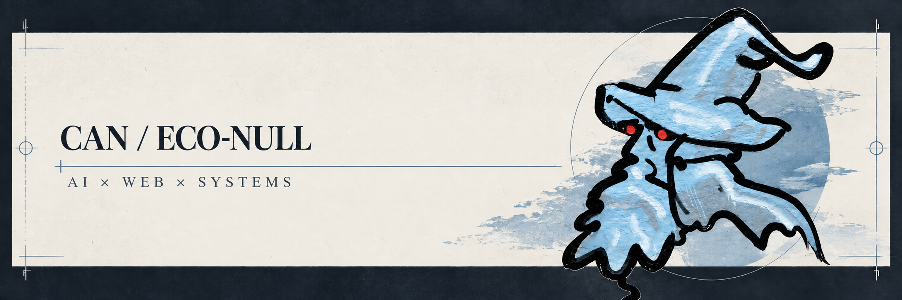

  

  <strong>Software Developer & Founder building AI-driven products and developer tools.</strong> 
  Founder of <a href="https://postready.org"><strong>PostReady</strong></a> · Crafting autonomous workflows, full-stack applications, and self-hosted systems.

---

## What I Do

- **Founder @ [PostReady](https://postready.org):** Building an AI content repurposing studio turning technical articles, notes, and documentation into platform-native social content for X & LinkedIn.
- **Autonomous Systems:** Engineering resilient multi-agent architectures, background orchestrators, and production self-hosted infrastructure.
- **Full-Stack & Developer Tooling:** Designing focused web applications, API integrations, and developer-first utilities.

## Stack & Technologies

- **Languages:** TypeScript, Python, JavaScript, SQL, Bash
- **Frontend & App:** Next.js (App Router), React, Tailwind CSS, Vite
- **Backend & Cloud:** Node.js, FastAPI, PostgreSQL / Supabase, Docker, Cloudflare
- **AI & Automation:** Autonomous Agent Runtimes, LLM Orchestration, Vector DBs (Qdrant)

## Projects & Ecosystem

- **[PostReady.org](https://postready.org):** AI content repurposing studio & free developer utilities.
- **[PostReady on GitHub](https://github.com/postready):** Open-source distribution tooling & social media datasets.

  Building in public · Focused on shipping tools that developers and founders actually use.

